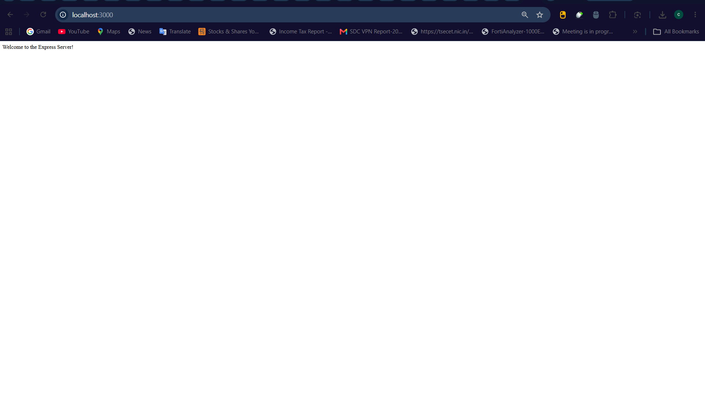
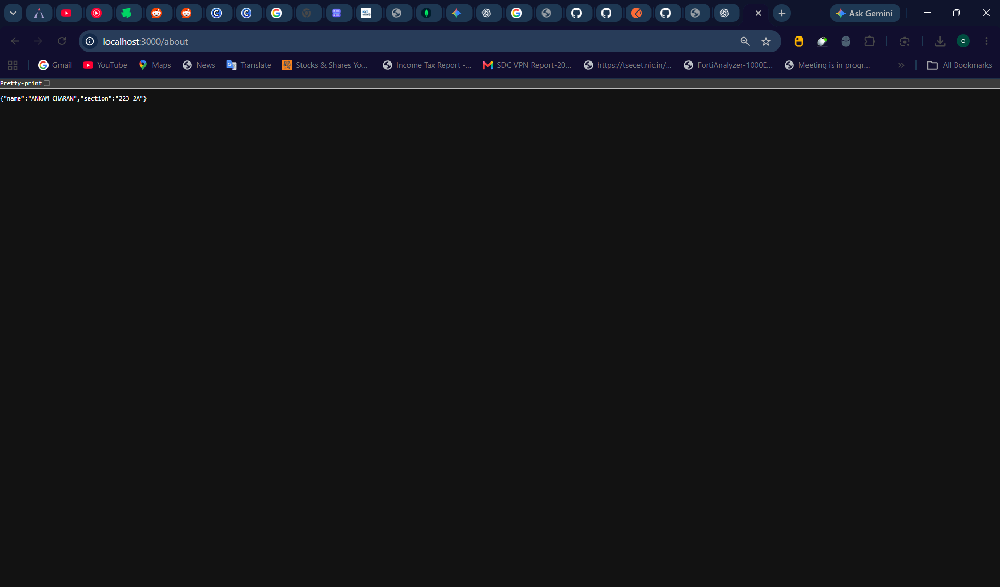
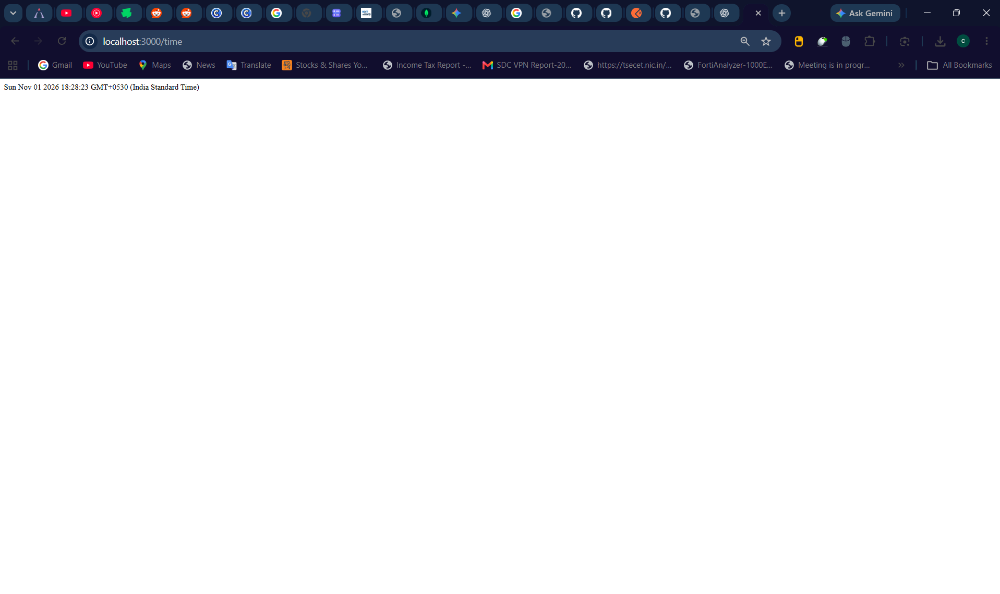
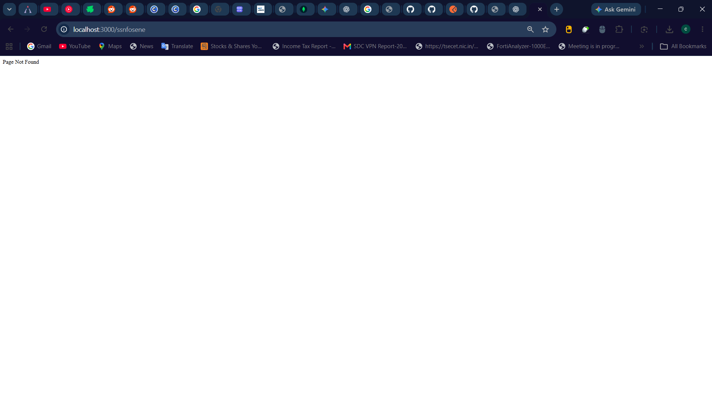

# Lab 1: Node.js and Express Server

**Deployment URL:** (https://backend-labs-aurora.onrender.com/)

---

## Student Details

| Field | Details |
|-------|---------|
| **Name** | ANKAM CHARAN |
| **Registration Number** | 252U1R1013 |
| **Section** | 223 2A |
| **Course** | Backend Development Fundamentals |
| **Lab** | Lab 1 – Node.js and Express Server |

---

## Objective

To set up a Node.js project and build a small web server using the built-in HTTP module, then create a web server using Express.js.

---

## Project Description

This project demonstrates two approaches to building a web server in Node.js:

1. **http-server.js** – Uses Node's built-in `http` module to create a server that responds with `Hello` to every request.
2. **server.js** – Uses Express.js to provide three named routes (`/`, `/about`, `/time`) and returns a `404` response for any unknown route.

---

## Technologies Used

- Node.js
- Express.js
- JavaScript
- npm

---

## Project Structure

```
lab-01/
├── node_modules/
├── screenshots/
│   ├── home.png
│   ├── about.png
│   ├── time.png
│   └── unknown.png
├── .gitignore
├── http-server.js
├── package-lock.json
├── package.json
├── README.md
└── server.js
```

---

## Explanation of package.json

The `package.json` file stores information about the Node.js project and its dependencies.

- **name**: Specifies the project name.
- **version**: Specifies the current project version.
- **description**: Provides a short description of the project.
- **main**: Specifies the main entry file (`server.js`).
- **scripts**: Defines commands that can be executed using npm.
- **author**: Specifies the project author.
- **license**: Specifies the project's license.
- **dependencies**: Lists packages required by the application (`express`).

The `package-lock.json` file records the exact dependency versions used for installation. The `node_modules` folder contains the installed packages.

---

## Installation

### Prerequisites

- Node.js installed on the computer.
- npm, which is installed with Node.js.

### Steps

1. Clone the GitHub repository:

```bash
git clone https://github.com/Invy4/backend_labs_AURORA.git
```

2. Navigate to the Lab 1 folder:

```bash
cd backend_labs_AURORA/lab-01
```

3. Install the required dependencies:

```bash
npm install
```

The `node_modules` folder is generated automatically when the dependencies are installed.

---

## Execution

### 1. Run the Basic HTTP Server

Run the following command:

```bash
node http-server.js
```

Open the following URL in your browser:

```
http://localhost:3000
```

The basic HTTP server returns `Hello` for every request.

Stop the server by pressing `Ctrl + C` before starting the Express server.

### 2. Run the Express Server

Run the following command:

```bash
node server.js
```

Open the following URL in your browser:

```
http://localhost:3000
```

The Express server displays the welcome message.

---

## API Endpoints

The following endpoints are provided by the Express server (`server.js`).

| Method | Endpoint | Description | Expected Status |
|--------|----------|-------------|-----------------|
| GET | `/` | Returns a welcome message. | 200 OK |
| GET | `/about` | Returns JSON with student name and section. | 200 OK |
| GET | `/time` | Returns the current date and time. | 200 OK |
| GET | Any unknown path | Returns a Page Not Found message. | 404 Not Found |

---

## Screenshots

The following screenshots demonstrate the endpoint responses.

### 1. Home Endpoint – GET /




### 2. About Endpoint – GET /about



### 3. Time Endpoint – GET /time



### 4. Unknown Route – 404 Response



---

## Testing

The endpoints can be tested by opening their URLs in a web browser.

- Open `/` and check that the welcome message is displayed with status code 200.
- Open `/about` and check that the student's name and section are returned as JSON with status code 200.
- Open `/time` and check that the current date and time are displayed with status code 200.
- Open an unknown route such as `/unknown` and check that the server returns status code 404.

---

## Notes: Problems Faced and Solutions

| Problem | Solution |
|---------|----------|
| Both servers use port 3000 | Run only one server at a time; stop with `Ctrl + C` before switching |
| `node_modules` being committed | Added `node_modules/` to `.gitignore`; reinstall with `npm install` |
| Understanding `http` vs Express | `http` is lower-level and requires manual routing; Express abstracts this cleanly |

---

## Important Notes

- Install dependencies using `npm install`.
- Do not upload the `node_modules/` folder to GitHub.
- Do not commit or share any `.env` file containing secrets.
- The HTTP server and Express server both use port 3000 – run them one at a time.
- Ensure all screenshot files exist in the `screenshots/` folder before submission.
